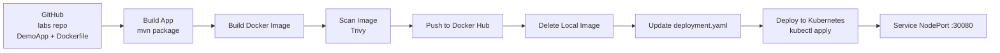

# Lab 21: Jenkins Pipeline for Application Deployment

## Lab Objective

Clone a Spring Boot application (with its `Dockerfile`) and build a complete Jenkins
CI/CD pipeline that automatically:

1. Builds the application.
2. Builds a Docker image.
3. Scans the image for vulnerabilities.
4. Pushes the image to Docker Hub.
5. Deletes the image from the local Docker daemon.
6. Updates the image tag inside the Kubernetes deployment file.
7. Deploys the new image to a Kubernetes cluster.
8. Runs post actions for `always`, `success` and `failure`.

---

## Architecture



**Tools used**

| Tool | Purpose |
|------|---------|
| Jenkins (v2.5xx) | CI/CD orchestration |
| Maven + JDK 17/21 | Build the Spring Boot application |
| Docker | Build, scan and push the image |
| Trivy | Container image vulnerability scanning |
| Docker Hub | Image registry |
| Kubernetes (minikube) | Deployment target |

---

## Repository Structure

```text
Jenkins/lab21/
├── DemoApp/                 # Cloned lab application
│   ├── Jenkinsfile          # Declarative pipeline (7 stages + post actions)
│   ├── deployment.yaml      # Kubernetes Deployment + NodePort Service
│   ├── Dockerfile           # Runtime image (slim JRE base)
│   ├── pom.xml
│   └── src/
└── README.md                # This document
```

The application and its `Dockerfile` were cloned from the official lab repository
and committed under `DemoApp/`:

```text
https://github.com/Ibrahim-Adel15/DemoApp.git
```

Following the common convention, the `Jenkinsfile` lives in the root of the
application folder, next to `pom.xml` and `Dockerfile`.

> **Dockerfile adjustment.** The original lab `Dockerfile` used `maven:sapmachine`
> as the *runtime* base, which produced a **737 MB** image because it ships a
> full Maven + JDK toolchain that is never used at runtime. Since the pipeline
> builds the JAR with Maven in stage 1, the runtime image only needs a JRE:
> it now uses `eclipse-temurin:17-jre` (**~200 MB**). This keeps the Docker Hub
> push short enough to survive a slow/unstable connection.

---

## Prerequisites

- Jenkins is installed and reachable on **http://localhost:8081** (see Lab 20 for
  the port change from `8080` to `8081`).
- Docker is installed and the `jenkins` user can use it.
- A Kubernetes cluster is running (minikube) and `kubectl` is configured.
- `trivy` is installed on the Jenkins machine.
- A Docker Hub account with an **Access Token** (Read & Write).

---

## Environment Setup

### 1. Allow the `jenkins` user to use Docker

```bash
sudo usermod -aG docker jenkins
sudo systemctl restart jenkins
```

Verify:

```bash
sudo -u jenkins -H docker info --format '{{.ServerVersion}}'
```

### 2. Give the `jenkins` user access to the Kubernetes cluster

Jenkins runs as the `jenkins` system user, so it needs its own kubeconfig with the
cluster certificates embedded (no dependency on `/home/<user>/.minikube`):

```bash
sudo mkdir -p /var/lib/jenkins/.kube
kubectl config view --minify --context=minikube --flatten \
  | sudo tee /var/lib/jenkins/.kube/config > /dev/null
sudo chown -R jenkins:jenkins /var/lib/jenkins/.kube
sudo chmod 700 /var/lib/jenkins/.kube
sudo chmod 600 /var/lib/jenkins/.kube/config
```

Verify:

```bash
sudo -u jenkins -H kubectl get nodes
```

### 3. Download the Trivy vulnerability database

Doing this once before the first build keeps the scan stage fast:

```bash
sudo -u jenkins -H trivy image --download-db-only
```

### 4. Store the Docker Hub credentials in Jenkins

1. Create an Access Token in Docker Hub: **Account settings → Security → New Access Token**
   (permissions: *Read & Write*).
2. In Jenkins: **Manage Jenkins → Credentials → System → Global credentials → Add Credentials**.
3. Fill in:

| Field | Value |
|-------|-------|
| Kind | Username with password |
| Scope | Global |
| Username | Docker Hub username |
| Password | Docker Hub access token |
| ID | `dockerhub-creds` |
| Description | DockerHub account |

> The ID **must** be `dockerhub-creds` because it is referenced by the `withCredentials`
> block in the `Jenkinsfile`.

---

## Pipeline Stages

| # | Stage | What it does |
|---|-------|--------------|
| 1 | `Build App` | `mvn -B clean package -DskipTests` → `target/demo-0.0.1-SNAPSHOT.jar` |
| 2 | `Build Docker Image` | `docker build -t <user>/demoapp:<BUILD_NUMBER> .` |
| 3 | `Scan Docker Image` | `trivy image --severity HIGH,CRITICAL` (report only) |
| 4 | `Push to DockerHub` | `docker login` using `dockerhub-creds`, then `docker push` |
| 5 | `Delete Local Image` | `docker rmi -f <image>` |
| 6 | `Update Deployment File` | `sed` replaces the `image:` line in `DemoApp/deployment.yaml` |
| 7 | `Deploy to Kubernetes` | `kubectl apply -f`, then `kubectl rollout status` |
| — | `post { always / success / failure }` | Logout from Docker Hub, print the build result and a stage-aware message |

The source code is obtained by the **SCM checkout** of the job itself (Jenkins
clones the repository, including `DemoApp/`, before the pipeline starts), so the
stages map 1:1 to the seven steps required by the lab.

### Pipeline global configuration

```groovy
environment {
    DOCKERHUB_USER  = '<dockerhub-username>'
    IMAGE_NAME      = "${DOCKERHUB_USER}/demoapp"
    IMAGE_TAG       = "${BUILD_NUMBER}"     // unique tag per build
    FULL_IMAGE      = "${IMAGE_NAME}:${IMAGE_TAG}"
    APP_DIR         = 'Jenkins/lab21/DemoApp'
    DEPLOYMENT_FILE = "${APP_DIR}/deployment.yaml"
}
```

Using `${BUILD_NUMBER}` as the tag guarantees that every build produces a different
image, which is what makes the *"update image in the deployment file"* stage
meaningful (instead of re-deploying the same `latest` image).

---

## Creating the Jenkins Job

1. **New Item** → name: `lab21-demoapp-pipeline` → type: **Pipeline** → **OK**.
2. Under **Pipeline**:
   - Definition: **Pipeline script from SCM**
   - SCM: **Git**
   - Repository URL: `https://github.com/<your-user>/ivolve-Devops-Training.git`
   - Branch Specifier: `*/main`
   - Script Path: `Jenkins/lab21/DemoApp/Jenkinsfile`
3. **Save** → **Build Now**.

---

## Kubernetes Manifests

`deployment.yaml` contains two resources:

| Resource | Details |
|----------|---------|
| `Deployment/demoapp` | 1 replica, container port `8080`, `imagePullPolicy: Always`, readiness probe on `/` |
| `Service/demoapp` | `NodePort` — port `30080` → container port `8080` |

The `image:` field is the only part the pipeline rewrites:

```yaml
image: <dockerhub-user>/demoapp:<build-number>
```

---

## Verification

After a successful build:

**1. Jenkins console output** shows all stages green and the post action message.

**2. The image exists on Docker Hub** with the build number as tag:

```bash
docker pull <dockerhub-user>/demoapp:<build-number>
```

**3. The local image was deleted** (stage 5):

```bash
docker images <dockerhub-user>/demoapp
```

**4. The workload is running in Kubernetes:**

```bash
kubectl get pods -l app=demoapp
kubectl get svc demoapp
kubectl rollout history deployment/demoapp
```

**5. The application responds:**

```bash
curl http://$(minikube ip):30080
# Hello from Dockerized Spring Boot!
```

---

## Troubleshooting

| Problem | Cause / Fix |
|---------|-------------|
| `permission denied` on `/var/run/docker.sock` | `jenkins` user is not in the `docker` group → `sudo usermod -aG docker jenkins && sudo systemctl restart jenkins` |
| `The connection to the server ... was refused` | The cluster is down → `minikube start --driver=docker` (it stops when WSL restarts) |
| `ErrImagePull` / `ImagePullBackOff` | The image was not pushed, or the tag in `deployment.yaml` is wrong |
| `unauthorized: incorrect username or password` | The Jenkins credential must contain a Docker Hub **access token**, not the account password |
| Trivy scan is very slow | The vulnerability DB was not downloaded yet → run the *download-db-only* step once |
| `no space left on device` during the scan | `/tmp` is a small tmpfs in WSL → the pipeline points `TMPDIR` to `$WORKSPACE/.trivy-tmp` (disk-backed) |
| `timeout awaiting response headers` during `docker push` | The connection is too slow for a large layer → the runtime image uses a slim JRE base and the push is wrapped in `retry(3)` (already-uploaded layers are skipped) |
| Node stuck on *"Waiting for next available executor"* | Jenkins marked the built-in node offline because free space in `/tmp` dropped below 1 GiB → set `-Djava.io.tmpdir=/var/tmp/jenkins` in a systemd drop-in and restart Jenkins |
| Build fails with `Killed` / OOM | Too little memory in WSL → start minikube with less memory (`minikube start --memory=2048mb`) and retry |

---

## Cleanup

```bash
kubectl delete -f Jenkins/lab21/DemoApp/deployment.yaml
docker logout
```

---

## Screenshots

<!-- Add the screenshots taken while running the lab, for example:


-->

---

## Conclusion

This lab demonstrates a complete CI/CD workflow for a containerized application.
Jenkins builds the application and the Docker image, scans it with Trivy, pushes it
to Docker Hub, removes the local copy, rewrites the Kubernetes manifest with the new
image tag and deploys it to the cluster — all from a single declarative `Jenkinsfile`
with proper `post` actions for success and failure handling.
